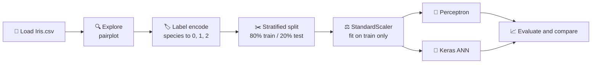

<div align="center">

# 🌸 Iris Flower Classification: Perceptron vs Neural Network

**Classifying iris species from petal and sepal measurements, comparing a single-layer Perceptron with a multi-layer ANN built in Keras**


-blue?style=flat-square)


</div>

---

## 📑 Table of Contents

1. [Overview](#-overview)
2. [Dataset](#-dataset)
3. [Workflow](#-workflow)
4. [Models](#-models)
5. [Results](#-results)
6. [Getting Started](#-getting-started)
7. [Project Structure](#-project-structure)
8. [Key Learnings](#-key-learnings)
9. [Future Improvements](#-future-improvements)

---

## 🚀 Overview

This project predicts the species of an iris flower (*Setosa*, *Versicolor* or *Virginica*) from four measurements. Two models are trained on the same data so their results can be compared directly:

| Model | Type | Library |
|---|---|---|
| **Perceptron** | Single-layer linear classifier | scikit-learn |
| **ANN** | Multi-layer neural network (4 → 16 → 8 → 3) | TensorFlow / Keras |

The project covers a full beginner-friendly machine learning pipeline: exploring the data, preprocessing, training, evaluating and comparing models.

---

## 📊 Dataset

The classic **Iris dataset** (R. A. Fisher, 1936), available from the [UCI Machine Learning Repository](https://archive.ics.uci.edu/dataset/53/iris). It is included here as `Iris.csv`.

| Property | Value |
|---|---|
| Samples | 150 |
| Features | 4 (all in cm) |
| Classes | 3, with 50 samples each (balanced) |

| Feature | Description |
|---|---|
| `SepalLengthCm` | Sepal length |
| `SepalWidthCm` | Sepal width |
| `PetalLengthCm` | Petal length |
| `PetalWidthCm` | Petal width |
| `Species` | Target: `Iris-setosa`, `Iris-versicolor`, `Iris-virginica` |

The `Id` column is dropped before training because it carries no information.

---

## 🔄 Workflow



1. **Load and explore:** a seaborn pairplot coloured by species shows how well the classes separate.
2. **Encode labels:** `LabelEncoder` converts species names to 0, 1, 2.
3. **Split:** 80/20 train/test split with `stratify` so every class is equally represented in both sets (120 train, 30 test).
4. **Scale:** `StandardScaler` is fitted on the training set only and then applied to the test set, which avoids data leakage.
5. **Train and evaluate** both models on the scaled data.

---

## 🧠 Models

### Perceptron (baseline)

```python
Perceptron(max_iter=1000, random_state=42)
```

A single-layer linear classifier. It is fast and simple, but it can only draw straight decision boundaries.

### Artificial Neural Network (Keras)

| Layer | Units | Activation | Parameters |
|---|:-:|:-:|:-:|
| Dense (input: 4 features) | 16 | ReLU | 80 |
| Dense | 8 | ReLU | 136 |
| Dense (output) | 3 | Softmax | 27 |
| | | **Total** | **243** |

```python
model = Sequential([
    Dense(16, input_dim=4, activation='relu'),
    Dense(8, activation='relu'),
    Dense(3, activation='softmax')
])
model.compile(optimizer='adam', loss='categorical_crossentropy', metrics=['accuracy'])
```

| Setting | Value |
|---|---|
| Optimizer | Adam |
| Loss | Categorical cross-entropy (labels one-hot encoded with `to_categorical`) |
| Epochs | 100 |
| Batch size | 8 |
| Validation split | 20% of the training data |

---

## 📈 Results

Both models are evaluated on the same held-out test set of 30 flowers.

| Model | Test accuracy |
|---|:-:|
| Perceptron | **86.67%** |
| ANN (Keras) | **93.33%** |

The extra hidden layers let the ANN capture non-linear patterns, which gains about 6.7 percentage points over the Perceptron.

### Perceptron: classification report

| Class | Precision | Recall | F1-score | Support |
|---|:-:|:-:|:-:|:-:|
| 0 (Setosa) | 0.83 | 1.00 | 0.91 | 10 |
| 1 (Versicolor) | 0.88 | 0.70 | 0.78 | 10 |
| 2 (Virginica) | 0.90 | 0.90 | 0.90 | 10 |
| **Accuracy** | | | **0.87** | 30 |

*Versicolor is the hardest class for the linear model. It overlaps with Virginica in feature space.*

> [!NOTE]
> The test set has only 30 samples, so one extra correct or wrong prediction changes accuracy by about 3.3 points. Treat these numbers as indicative, not definitive.

---

## ⚡ Getting Started

```bash
# 1. Clone the repository
git clone https://github.com/<your-username>/iris-flower-classification-ann.git
cd iris-flower-classification-ann

# 2. (Optional) create a virtual environment
python -m venv .venv
source .venv/bin/activate        # Windows: .venv\Scripts\activate

# 3. Install dependencies
pip install -r requirements.txt

# 4. Launch the notebook
jupyter notebook ANN2.ipynb
```

Run the cells from top to bottom. `Iris.csv` must be in the same folder as the notebook.

---

## 📁 Project Structure

```text
iris-flower-classification-ann/
├── ANN2.ipynb          # Full pipeline: EDA, preprocessing, Perceptron, ANN
├── Iris.csv            # Dataset
├── requirements.txt    # Python dependencies
└── README.md
```

---

## 🎓 Key Learnings

- Why **feature scaling** matters for neural networks, and why the scaler must be fitted on training data only.
- How **stratified splitting** keeps class balance in small datasets.
- The difference between a **linear classifier** (Perceptron) and a **multi-layer network** with non-linear activations.
- How **softmax** with **categorical cross-entropy** handles multi-class output.
- Reading a **classification report** (precision, recall, F1) instead of relying on accuracy alone.

---

## 🔭 Future Improvements

- [ ] Add a confusion matrix plot for both models
- [ ] Plot training and validation loss curves, and use early stopping
- [ ] Try cross-validation for a more stable accuracy estimate
- [ ] Compare against Logistic Regression, SVM and Random Forest
- [ ] Experiment with `Dropout` and different layer sizes

---

<div align="center">

⭐ **If you found this useful, give the repo a star!** ⭐

</div>
